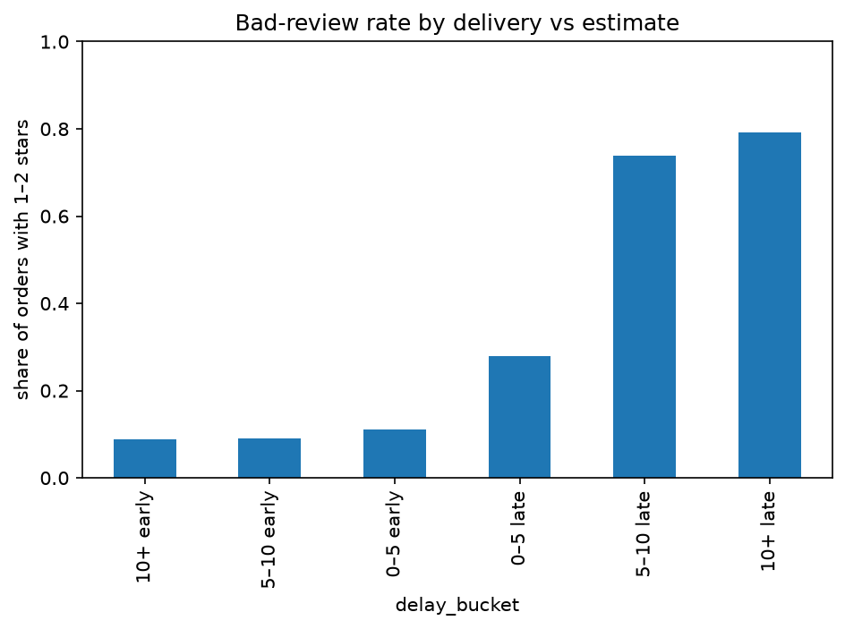
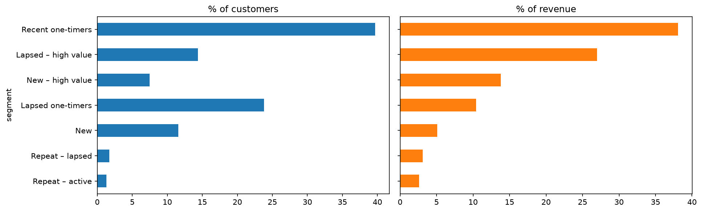
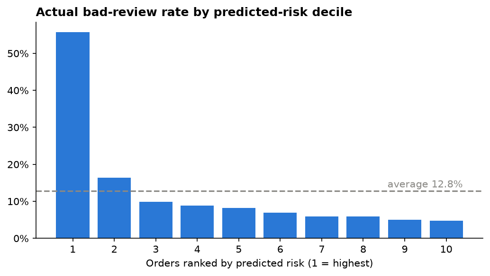

# Olist Customer Retention & Satisfaction

An end-to-end data science project on e-commerce data stored in PostgreSQL: customer
segmentation, a repeat-purchase model, a bad-review model, and a Streamlit dashboard.

## Business questions
1. Who are our customers, and what should marketing do for each group?
2. Can we predict from a customer's first order whether they place a second one?
3. What drives unhappy customers (1-2 star reviews), and can we predict it?

## Data
The public [Olist Brazilian E-Commerce dataset](https://www.kaggle.com/datasets/olistbr/brazilian-ecommerce),
loaded into a PostgreSQL database named `ecommerce`: 99,441 orders from 96,096 customers
(September 2016 to October 2018).

| Table | Rows | Content |
|---|---|---|
| customers | 99,441 | customer ID per order, real customer ID, state |
| orders | 99,441 | status and purchase / delivery timestamps |
| order_items | 112,650 | products, sellers, price, freight |
| order_payments | 103,886 | payment type, installments, value |
| order_reviews | 99,224 | review score and comment |
| products | 32,951 | category, weight, photos |
| category_translation | 71 | Portuguese to English category names |

Customers are identified by `customer_unique_id`, because Olist creates a new `customer_id`
for every order.

## Method
1. **SQL:** one query joins orders, customers, items, payments, reviews and products into one row per order.
2. **Cleaning:** removed canceled and unavailable orders, kept January 2017 to August 2018 (97,910 orders).
3. **Repeat-purchase target:** a second order 1 to 180 days after the first. Same-day second orders
   were removed because about 40% of apparent repeats were split shopping sessions, not real returns.
4. **Features** come from the first order only, to avoid leaking the future.
5. **Models** compared with cross-validation, using ROC-AUC, PR-AUC and lift (accuracy is misleading
   when only 1.9% of customers repeat).
6. **Bad-review target:** review score of 1 or 2. Model A uses order-time information (early warning);
   model B adds the delivery outcome (diagnosis).
7. **Segmentation:** seven rule-based RFM segments plus K-Means clustering (k = 4).

## Key results

| Finding | Result |
|---|---|
| Customers with more than one order | 3.0% (2,875 of 94,707) |
| Repeat-purchase model (cross-validated) | ROC-AUC 0.57, top-decile lift 1.36x: weak but real signal |
| Overall bad-review rate | 12.8% |
| Bad-review rate when delivery is 5+ days late | 74% to 79% (vs about 10% on time) |
| Bad-review model B (test set) | ROC-AUC 0.762, PR-AUC 0.497 (3.9x the base rate) |
| Bad-review model A (cross-validated) | PR-AUC 0.244 (1.9x the base rate) |
| Bad-review rate by items in order | 11% (1 item), 25% (2 items), about 34% (4+ items) |
| Lapsed high-value customers | 14% of customers, 27% of revenue |







## Dashboard
The Streamlit app has five pages: overview, segments (with a customer explorer and CSV download),
delivery and reviews, a bad-review risk calculator, and the repeat-purchase model.

## Project structure
```
olist-churn-project/
├── .env                      database credentials (not committed)
├── requirements.txt
├── src/
│   ├── db.py                 PostgreSQL connection
│   └── data_loader.py        the SQL query, one row per order
├── notebooks/
│   ├── 01_eda.ipynb          clean data and explore
│   ├── 02_features.ipynb     repeat-purchase target and features
│   ├── 03_model.ipynb        repeat-purchase model
│   ├── 04_bad_review.ipynb   bad-review models A and B
│   ├── 05_segmentation.ipynb RFM segments and K-Means
│   └── 06_report_charts.ipynb charts for the report
├── data/                     intermediate tables (not committed)
├── artifacts/                saved models, tables, metrics
├── app/streamlit_app.py      dashboard
└── reports/                  figures and written report
```

## How to run
1. Install PostgreSQL, create a database named `ecommerce`, and load the Olist CSV files.
2. Create a `.env` file in the project root:
   ```
   DB_USER=postgres
   DB_PASSWORD=your_password
   DB_HOST=localhost
   DB_PORT=5432
   DB_NAME=ecommerce
   ```
3. Set up the environment:
   ```
   python -m venv .venv
   .venv\Scripts\activate
   pip install -r requirements.txt
   ```
4. Run the notebooks `01` to `06` in order.
5. Start the dashboard:
   ```
   streamlit run app/streamlit_app.py
   ```

## Limitations
- The repeat-purchase signal is weak (ROC-AUC about 0.57): it ranks customers better than chance
  but is not precise enough for individual targeting.
- The data is observational. Test any win-back offer with an A/B test before scaling it.
- Bad-review model B uses the delivery outcome, so it explains dissatisfaction rather than
  warning in advance. Model A is the early warning.
- The higher bad-review rate for multi-item orders is unexplained; partial deliveries are a hypothesis.
- Random train/test splits were used, not time-based splits.

## Next steps
- Predict late delivery so warnings can fire before the order arrives.
- Investigate multi-item shipments.
- Re-evaluate with time-based splits and test a longer repeat horizon.
- A/B test a win-back offer on the lapsed high-value segment.
